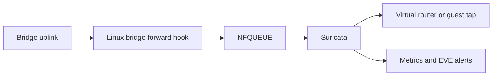

# cs-public0

Suricata inspection for IPv4 traffic forwarded through a Linux bridge, with an
Ansible installer, scoped nftables rules, systemd lifecycle and Prometheus metrics.
Apache CloudStack on KVM is one deployment example; the controller does not require
CloudStack APIs, credentials or agents.

The default profile accepts **alert-only** signatures and rejects `bypass` options.
The included signature is a connectivity example, not a threat feed. Operators supply and review their own
rulesets. This project does not install or redistribute the Suricata engine.
Threshold and rate-filter overrides are disabled with an explicit empty source
(`threshold-file: /dev/null`).

Rule files must use UTF-8 and LF line endings. Every physical line, including
comments and whitespace, is limited to 4096 UTF-8 bytes. Active `alert` rules start in column
one and occupy one physical line; continuation lines are not accepted. Other
control or non-printable characters are refused, including CR from CRLF files.
Tabs are allowed within a line. Escape literal semicolons as `\;`, including in
quoted option values. Option keywords are checked without case sensitivity, and
`bypass` is rejected in every case. Full Suricata syntax validation still runs
before activation.

## Traffic path



The selector matches IPv4 with the same configured incoming and outgoing bridge.
Host input/output, IPv6 and traffic on other bridges remain outside this scope.
Existing firewall chains still apply after a packet leaves this inspection hook.

## Requirements

- Linux with bridge-family nftables, NFQUEUE and network namespace support.
- Suricata **8.x** built with NFQUEUE support; Python **3.10+**, nftables and systemd.
- Ansible Core **2.20.x** and Python **3.12+** on the deployment controller.
- An existing bridge and an operator-selected queue number unused by other services.
- Out-of-band access and a rollback window for first activation on each host type.

See [compatibility](docs/compatibility.md) for kernel, offload and validation limits.

## Install without activating interception

Create an inventory using [the CloudStack/KVM example](examples/apache-cloudstack-kvm/).
Change the example hostname and set `cs_public0_home_net` to the intended networks.

```sh
python3 -m venv .venv
. .venv/bin/activate
pip install -r requirements-dev.txt
cd ansible
ansible-playbook -i ../examples/apache-cloudstack-kvm/inventory.ini site.yml \
  -e @../examples/apache-cloudstack-kvm/settings.yml
```

`cs_public0_enabled` defaults to `false`. The playbook installs and validates files
while leaving the interception service disabled. A running or enabled distribution
`suricata.service` must be dealt with explicitly before installation. Review its
updater too: starting it later conflicts with the inline service.

After checking the host, rules, memory limits and recovery access, activate using
the same playbook with `-e '{"cs_public0_enabled": true}'`. Activation starts the sensor,
authenticates its command socket and queue ownership, then adds a dedicated table.
The playbook stops an existing managed service before replacing its artifacts;
updates therefore include a bypass interval.

```sh
sudo systemctl status cs-public0.service cs-public0-monitor.timer
sudo /usr/local/libexec/cs-public0 status
sudo /usr/local/libexec/cs-public0 monitor
```

See [installation](docs/installation.md), [rollback](docs/rollback.md) and
[troubleshooting](docs/troubleshooting.md) for the complete operating procedure.

## Availability and inspection limits

`queue bypass` accepts new packets when no listener exists; `nfq.fail-open` allows
new packets when the queue overflows. Explicit memory exception policies prefer
forwarding over complete inspection. These mechanisms can reduce detection coverage.
A live but stalled listener can still hold queued packets. The monitor reports
observed problems; it does **not** automatically remove rules or restart services.

On Linux 6.8 and 6.11, fail-open can accept packets when the queue is full or
delivery to userspace fails without increasing the exported queue drop counters.
The monitor cannot detect those bypass events from these counters.
`telemetry_known=1` means the expected observations are available; zero drops or
a clear degraded latch do not prove complete inspection. See the
[upstream references](docs/references.md) and qualify the actual kernel.

An alert-only ruleset does not guarantee zero packet loss: parser behavior, kernel
resources and software faults are independent of signature actions. TLS payloads
remain encrypted. No universal throughput or latency guarantee is implied.

## Tests

```sh
python3 -m unittest discover -s tests -v
# Isolated Linux dataplane smoke, requires root and the binaries listed above:
sudo python3 tests/integration/netns.py
```

The smoke creates disposable namespaces and veth pairs; it never changes physical
interfaces or the root namespace firewall. It checks a real HTTP response, a
correlated Suricata alert, traffic in both directions, bypass after sensor exit
and preservation of an unrelated table. Exit **77** means unavailable prerequisites,
not a passed test. This smoke does not replace systemd or physical-host qualification.

## Layout

| Path | Purpose |
|---|---|
| `runtime/` | Standard-library controller and telemetry collector |
| `ansible/` | Installation and explicit activation |
| `config/` | Suricata, service and retention templates |
| `monitoring/` | Prometheus alerts and Grafana dashboard |
| `examples/` | Documentation-only inventory and networks |
| `tests/` | Unit, template and isolated dataplane tests |
| `docs/` | Architecture, security model and operation |

## License

The automation, templates, tests and documentation in this repository are licensed
under [Apache License 2.0](LICENSE). Suricata, third-party signature feeds and system
packages retain their own licenses; they are external dependencies. See
[NOTICE](NOTICE) and [SECURITY.md](SECURITY.md).
