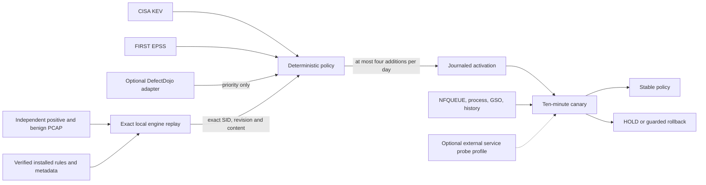

# Automatic exploit policy

For an already accepted `STABLE` controller, the installer also provides the
explicit `controller_migration_v3` tag. It requires one pinned target and a
state/config/unit snapshot. It stops future updater ticks, waits for the current
one to finish, locks the existing state, and installs an immutable v3 bundle and
configuration. Only the state's configuration hash changes; accepted rules,
canary results, baseline and history remain intact. The Suricata process is not
restarted. An interrupted mixed state stays quiescent for operator investigation;
the retained migration intent records the original bytes. This operation refuses
an active canary, an update due within 15 minutes, changed sources or a changed
state. The migration tag is excluded from default installation.

Implementation candidate. Live acceptance is a separate step: passing unit tests
does not mean the offline engine replay or a production canary has passed.

This optional day-2 controller changes selected signatures in an **already
installed, versioned Suricata ruleset** from ALERT to DROP. It does not fetch and
execute a new rules feed, manufacture signatures, scan applications, decrypt TLS,
or guarantee protection against zero-days. CVEs without an independently supplied
positive and benign corpus stay outside automatic promotion.

## What is eligible

All conditions must hold:

1. The CVE is in the complete, fresh CISA KEV catalog.
2. FIRST EPSS has a fresh, known probability at or above the installed cutoff
   (initial policy: `0.1`). An absent score is unknown, not zero.
3. The installed rule explicitly references that CVE. The message text is not a
   mapping source. SID, revision, normalized rule bytes and source ruleset match.
4. Offline replay with the pinned engine observes an alert on the independently
   supplied positive case, and observes every positive and benign HTTP flow.
5. That exact SID matches **none** of the benign cases, including partial uploads,
   log uploads containing exploit strings and source-code uploads.
6. Sensor identity, queue ownership, GSO, receive buffer, critical counters,
   fixed accounting/history baseline and resource margin pass the installed policy.
   The optional external profile additionally requires fresh service probes.

Existing DROP signatures are preserved. Ranking adds at most four new SIDs in
one batch, then waits for the canary and a day before another batch. DefectDojo
can prioritize relevant CVEs; it cannot bypass any condition above.

Each corpus flow has distinct source/destination addresses; benign cases precede
positives. Rules with `threshold`/`detection_filter` are excluded as
`RATE_LIMITED_RULE`, and replay requires an explicit pinned threshold file with
only comments/blank lines. Active global suppression/rate filters require a
separately qualified adapter: a missing benign alert must not hide a match.
The private replay uses `packet-alert-max: 255` and retains final EVE statistics.
It requires complete packet accounting and explicit zero alert-queue overflow
and suppression counters. Missing counters or any discarded/suppressed alert
reject qualification. These settings apply only to offline replay.
Suricata 8.0.7 accepts at most 255 for this setting. A logged fallback warning
also rejects qualification; the requested value is not assumed effective.
An unavailable/stale optional Dojo context is recorded and ignored for ranking;
it never permanently stops the public-source policy.

KEV is a catalog of known exploitation, not a popularity ranking. EPSS is a
probability estimate, not evidence that a particular request is malicious. The
corpus covers example patterns, not every exploit variant or every benign input.

## Installation, step by step

1. Install and accept the manual rule controller first. Verify `release.json`,
   all immutable inputs, selected rule actions and process-bound NFQUEUE/GSO.
2. Choose `canary_monitoring: local` for a controller with no remote-monitoring
   dependency. Set `service_checks: []` and omit `service_health_path`.
   Alternatively, choose the backwards-compatible `external` profile and
   arrange an existing external service monitor to publish a root-protected
   `cs-public0-service-health-v1` JSON snapshot. Do not use sensor uptime as proof
   that customer services work. The optional `exploit_adapters.py` reads an
   existing `cs_public0_probe_*` Prometheus instant vector; it generates no traffic.
   A fresh complete vector with `success=0` is a failed probe even when no TCP
   connection was established and `tcp_info_known=0`. In that case the adapter
   preserves the producer's integer retransmission placeholder for the installed
   v1 contract, explicitly marks it `retransmissions_known=false` and
   `PRODUCER_PLACEHOLDER_NOT_MEASURED`, and publishes `success=false`.
   It is the failed connection, not that placeholder, which can reach the
   existing guarded rollback path. A successful probe still requires known
   TCP_INFO. Missing series, stale/future publication or unknown success remain
   unavailable telemetry and cannot authorize rollback.
3. If desired, configure the read-only DefectDojo adapter. Give it a dedicated
   credential using systemd `LoadCredential`. Its output contains CVE IDs and a
   count, without finding titles, customers or raw findings. Use HTTPS.
   The legacy `allow_private_http` opt-in is restricted to loopback; it cannot
   send credentials to a remote private address over plaintext HTTP. For an
   existing TLS API reached by a private IP, `tls_server_name` explicitly sets
   the DNS identity checked by TLS and sent as SNI. Certificate-chain and name
   verification stay enabled, without changing DNS or relying on an HTTP Host
   override for TLS identity. Environment proxy variables are ignored for these
   credential-bearing adapter requests.
   This is a non-atomic sequence of offset pages, not a database snapshot.
   `finding_count` counts observed rows; `snapshot_complete` remains false.
   Changed counts, repeated/reversed IDs and short pages are rejected, but a
   simultaneous deletion and insertion can keep the count unchanged and omit
   an ID between pages. The context may affect ranking only; it cannot establish
   inventory completeness, absence of a vulnerability, or DROP eligibility.
4. Prepare an exact `cs-public0-auto-config-v1` JSON file. Pin every Python module
   in the separate automation bundle, the engine, YAML, settings, selected
   monitoring profile and the explicitly accepted sensor epoch. Set `mode: observe`.
   Put the expected `rcvbuf_size` (bytes, at most 16 MiB) at the configuration
   root. Keep `cfg` as the manual activation controller's exact eleven-key
   contract; adding receive-buffer metadata inside it invalidates activation.
   The sensor must expose finite `MemoryCurrent` and a positive finite
   `MemoryMax`; an unknown or unlimited memory envelope stops promotion.
   In the external profile encode `service_checks` as sorted triples, for example
   `[["external-owned-upload-host1", 2000, 5]]`: name, maximum duration in
   milliseconds, and maximum retransmissions. These are installed canary
   guards for that probe, not a measured SLO for all customer requests.
   Provide the exact serialized bytes and SHA256 to Ansible; the playbook does
   not recompute or silently replace an installed policy.

   Every decision fetches the complete KEV catalog again. Its publication age
   may be up to fourteen days because an unchanged catalog need not be released
   daily; EPSS scores retain a separate three-day maximum age. Missing, future
   or over-age inputs defer changes and preserve the installed policy.
5. Invoke `ansible/automatic-exploit-policy.yml` with one explicit `target`, source
   directory, configuration, initial rules SHA and `cs_public0_auto_enable: false`.
   This installs only the new bundle/timer. It does not restart the packet sensor,
   enable a selector, change its existing startup contract, or acknowledge history.
6. Review the offline replay's original EVE, PCAP/config/engine/rule hashes,
   correlated results and deferred reasons. `BENIGN_MATCH` rules must stay ALERT.
   The test uses a new private work directory and a sanitized copy of the actual
   detection settings; capture devices, production log outputs and the command
   socket are removed. Synthetic HOME_NET and IPS simulation are explicit.
7. Accept a pinned apply-mode policy for the canary host. Install it as a separate
   version with a new private state directory, then explicitly enable its timer.
   Never edit an installed policy under an existing state/configuration pin.
8. Observe original activation receipts and ten minutes of advancing sensor
   samples before accepting the host. The external profile additionally needs
   advancing probe samples. Do not use a zero exit code
   from `systemd-run` as proof of activation. Expand to other hosts separately.

   Each forwarding host needs its own fixed process/queue/history baseline.
   Roll out one host at a time and accept its complete canary before starting
   the next host. Installing source files or disabled timers is not acceptance.

### Local operation and optional external monitoring

Set `canary_monitoring: local`, `service_checks: []` and omit
`service_health_path` for operation independent of remote monitoring. The
controller still requires ten minutes, at least ten advancing sensor samples,
natural traffic progress, exact process/rules/queue identity, GSO and receive
buffer evidence, resource margin, and the fixed accounting/history guards.
It does not read a remote probe, create an echo backend, or manufacture a
successful service result. Acceptance explicitly records
`LOCAL_SENSOR_ONLY_NOT_SERVICE_AVAILABILITY`. Existing Grafana, Prometheus and
external checks remain independent observers. Local counters cannot establish
that every application remains available or detect every false positive.

The default `canary_monitoring: external` preserves the original behavior and
requires nonempty `service_checks` plus a fresh service-health file. In that
profile an external probe must actually traverse the monitored host; relabeling
another host's probe is invalid. Do not silently change an installed profile:
its configuration SHA, state and accepted activation remain bound together.

Neither profile resets/acknowledges history or restarts the sensor. The default
`baseline.accounting_gap_policy: fixed` stops promotion when the accounting gap
grows beyond the installed baseline. Operators who explicitly accept this known
accounting uncertainty may instead install `baseline.accounting_gap_policy: observe`
with `baseline.accounting_gap_acceptance: KNOWN_UNRESOLVED_ACCOUNTING_NOT_PACKET_LOSS`.
This preserves the original baseline and records initial, latest and maximum
observed gap in each local canary; it does not qualify inspection completeness
or interpret the gap as lost packets/requests. Existing monitoring and history
remain unchanged. Actual kernel/user/netlink loss, changed history or critical
counters, stale evidence and resource failures still stop promotion. This is an
explicit installed policy choice, never an automatic rebaseline or ACK.
An unavailable intelligence feed also retains the installed rules: KEV/EPSS are
inputs to future decisions, not dependencies for forwarding or existing DROP.

The initial corpus includes example Log4Shell, Shellshock, Laravel Ignition,
Grafana traversal, GitLab email-array reset, Drupal render, Struts OGNL and Tomcat
partial-session requests. This list describes tests, **not** guaranteed enabled
rules. Actual eligible SIDs come from the engine's observed alerts.

## Lifecycle and failures

| Condition | Behavior |
| --- | --- |
| Feed timeout, malformed or stale catalog/score | Retain installed policy; retry at most hourly |
| No newly eligible SID | Keep current rules and record the decision |
| No update due yet | Keep the current policy; existing sensor/service monitors retain their responsibility |
| Transient admission gates or unavailable probes before a new batch | Defer at most hourly; no rule changes and no permanent HOLD |
| Positive/benign evidence missing or changed | Stop promotion |
| Lost launch/reload reply, process crash after claim | Persist `HOLD`; never automatically retry the reload |
| Changed sensor epoch, new queue loss, critical counter/history change | `HOLD`; retain original evidence, do not reset/ACK or issue unsafe rollback |
| Confirmed canary service-probe failure with an unchanged healthy NFQUEUE control plane | Journaled rollback of this exact candidate, then `HOLD` for investigation |
| Canary completes with new observations and natural packet progress | `STABLE`; next candidate no earlier than one day later |
| Evidence store reaches its bound | Defer new batches hourly; resume after deliberate archival without resetting policy/history |

The default accounting profile carries an explicitly accepted historical gap as
a **fixed ceiling tied to one sensor epoch**. The separate opt-in `observe`
profile described above preserves and reports accounting uncertainty without
using that gap as a promotion ceiling. Neither profile calls it healthy, clears
it or automatically rebaselines its history. Existing DROP is preserved even when the external
intelligence source is unavailable. A freeze concerns policy updates; it does
not stop packet forwarding or disable an existing sensor.

The automation service has a one-core CPU quota, 2 GiB memory limit, no swap,
32 tasks and an eight-minute `TimeoutStartSec` bound for each oneshot. A cold
cache performs only replay; source selection and activation run in a later
invocation with their own full budget. The existing activation child has
its own two-GiB/four-minute envelope. These are engineering limits, not measured
capacity or reserved RAM. Full-load behavior, queue bursts, kernel/IRQ cost and
service latency still require separate qualification.

State and receipts live in the configured private state directory. Exact replay
uses the explicitly supported detection YAML profile, rather than an arbitrary
full upstream sample configuration. The deployed profile has these 13 top-level
sections: `vars`, `default-log-dir`, `outputs`, `app-layer`, `af-packet`,
`unix-command`, `detect`, `default-rule-path`, `rule-files`, `logging`, `flow`,
`stream` and `defrag`. NFQUEUE is selected by the sensor's command line; an `nfq`
YAML section is not required in this profile. Unknown sections remain rejected;
do not silently discard potentially detection-relevant settings.
Exact replay
evidence is retained once per rules/engine/config/corpus/code contract, rather
than copying the full ruleset each day. Daily decisions reference that proof.
Interrupted replay evidence is never overwritten or automatically deleted. A durable
`attempt-<key>.json` claim is written and synced before the replay callback. If the
process dies without a completed `qualified-<key>.json`, the next attempt refuses
the same contract and enters `HOLD`, rather than repeating work every timer tick.
An operator must investigate and authorize a new pinned qualification contract;
the automatic controller never deletes the old claim. A different contract uses a
new unique directory; only complete evidence receives an atomic cache reference.
Keep each active `qualified-*.json` reference and the `replay-*` directory it
names together on the host. Before archival, record both `is-enabled` and
`is-active` for `cs-public0-exploit-policy.timer` and, where installed,
`cs-public0-exploit-adapters.timer`. Use `systemctl disable --now` on these
timers so their boot triggers also stay disabled through a restart. Wait for
`cs-public0-exploit-policy.service` and `cs-public0-exploit-adapters.service`
to finish naturally; verify they are neither active nor activating. Never stop
or kill an active updater service for archival. Also
quiesce any separately installed legacy/manual rule updater and confirm no
`cs-public0-activate-*.service` transient activation is running or queued. An
activation child may outlive its parent: do not interrupt it or archive its
transaction; wait for a known terminal result, and investigate unknown journals.
Keep other operators/updaters quiescent throughout archival. Only after these
checks may an operator determine the unreferenced set and archive completed or
interrupted replay records that are no longer referenced
by any cache reference, current policy or active transaction. Preserve their
original bytes and hashes in the archive before removing the host copy. Verify
the archive, then restore each timer's exact recorded enabled/disabled and
active/inactive state; start only those that were active before maintenance.
If interrupted or rebooted, recheck all quiescence conditions and archive hashes
before resuming removal or restoring timers. Unknown
or active transaction journals require investigation first. Removing a
referenced qualification proof deliberately causes `HOLD`; it is an integrity
failure, not permission to reset state or silently replace missing evidence.
Inspect `state.json`, `batch-*/decision.json`, `replay-*/qualification.json`, original
`eve.json`/`engine.log`, and the transaction journal. Set up alerts on `HOLD`, stale
ticks and failed/stale adapters in the deployment's monitoring system. This
candidate does not claim that a particular external alerting integration is live.
Also alert on a continuously asserted deferral flag for more than two hours,
including a full evidence store; a fresh heartbeat alone does not prove that
new rules can still be promoted.
An optional `metrics_file` ending in `cs_public0_exploit_policy.prom` atomically
publishes the last completed tick, HOLD and deferral flags to a root-protected
node-exporter textfile directory. Alert on missing data and ticks older than
ten minutes, as well as HOLD; a stopped producer cannot publish its own failure.
The installed timer runs 30 seconds after the previous invocation ends
(`AccuracySec=1s`), with a 480-second service timeout. Thus the normal repeat
envelope is 511 seconds, leaving 89 seconds before the 600-second freshness
threshold. Every completed invocation publishes its timestamp, including a tick
that defers a decision or finds no update due; hourly backoff applies to new
decisions, not to this heartbeat. Enable these alerts only after the first fresh
publication. The separate boot trigger is two minutes after boot.
The probe adapter allows at most five seconds of future skew in remote query
evaluation timestamps. Producer publications from the future are rejected until
the consumer clock reaches their original timestamp. The controller-facing
timestamp is the original producer timestamp rounded down to integer seconds;
it is never capped at reception time. Repeated reads of one publication therefore
cannot become new samples as the consumer clock advances. This engineering
contract does not qualify clock alignment or customer latency.

When using VictoriaMetrics, account for its default 30-second query latency
offset as well as the producer and adapter intervals. A successfully ingested
probe may otherwise become older than the unchanged 120-second admission limit
before the next adapter refresh. For this existing five-series probe, an explicit
per-query `latency_offset=1ms` can read recent samples; exact-series, producer-age
and failure checks still apply. Do not change the global datasource or falsify
`observed_unix`. Run probe-only and Dojo-only readers in separate services and
timers (`exploit_adapters.py --only probe` and `--only dojo`). Optional Dojo
pagination, failure or timeout must not delay the next probe refresh. Sort Dojo
pages by their unique `id` using the API's `o=id` filter, and reject missing,
duplicate or non-increasing IDs across all pages; the context remains priority-only rather than DROP
authorization. Schedule probe starts at a fixed interval rather than adding
the Dojo pagination duration to every interval. See the
[VictoriaMetrics query latency documentation](https://docs.victoriametrics.com/victoriametrics/keyconcepts/#query-latency).

An interrupted canary is never automatically resumed. After investigating and
repairing a telemetry-only HOLD, `resume_confirmed_observation()` provides a pure
operator guard for the already confirmed candidate. Its adapter must stop future
ticks, acquire the existing updater lock, pin the full original HOLD (excluding
only the volatile last-tick timestamp), code, policy, plan and activation receipt,
and durably journal the original state and intended successor before publishing
the successor. It accepts only the exact stale-telemetry reason, one recovery,
the unchanged installed candidate and sensor/history, and a new fresh successful
probe under the same thresholds. It starts a NEW full 600-second observation
with zero accepted samples; it neither reloads rules nor erases the failed attempt.
Unknown claims, other HOLD reasons, new loss, changed history and repeated recovery
remain blocked. This guard is not part of the recurring automatic tick.

The recurring controller waits when either the fresh probe timestamp or
sensor sequence has not advanced. It does not count that tick as a new sample or
move the last accepted timestamp; the existing 120-second progress cap remains.
An equal or older failed probe cannot authorize rollback, including a failure
published within the same integer second or read from a delayed replica. Its full
schema, installed population, limits and freshness are still validated. A new
failed probe can authorize rollback only within the uninterrupted observation
budget; expired progress or a reversed clock requires investigation without a reload.
The pure `observe()` guard rejects duplicate inputs if called directly. An
installer must refuse active canary/launch/rollback phases before stopping timers,
wait with a bound for existing oneshots and restore the prior timer states if
installation fails. Existing configuration directory permissions are verified and
preserved rather than overwritten.
The day-2 installer must read the state directory from the pinned installed
policy and refuse missing state. A separate reviewed recovery function may be
loaded only after AST equality confirms that all other module statements match
the installed guard; it runs against the verified installed functions. This
keeps the recurring bundle unchanged and rejects incompatible threshold/schema
changes before any recovery record or state publication.

The probe adapter accepts Bearer auth or explicitly configured Basic auth. For
Basic auth the systemd credential contains the base64-encoded `user:password`;
never put that value into configuration, argv or logs.

## Sources

- [CISA KEV data](https://github.com/cisagov/kev-data)
- [FIRST EPSS API](https://www.first.org/epss/api)
- [Suricata 8.0.7 command-line options](https://docs.suricata.io/en/suricata-8.0.7/command-line-options.html)
- [Suricata 8.0.7 packet alert queue and fallback settings](https://docs.suricata.io/en/suricata-8.0.7/configuration/suricata-yaml.html#packet-alert-queue-settings)
- [Existing performance limitations](performance-pitfalls.md)

Patching remains necessary. Encrypted application payloads, missing signatures,
untested variants and incomplete inspection history remain explicit limitations.
