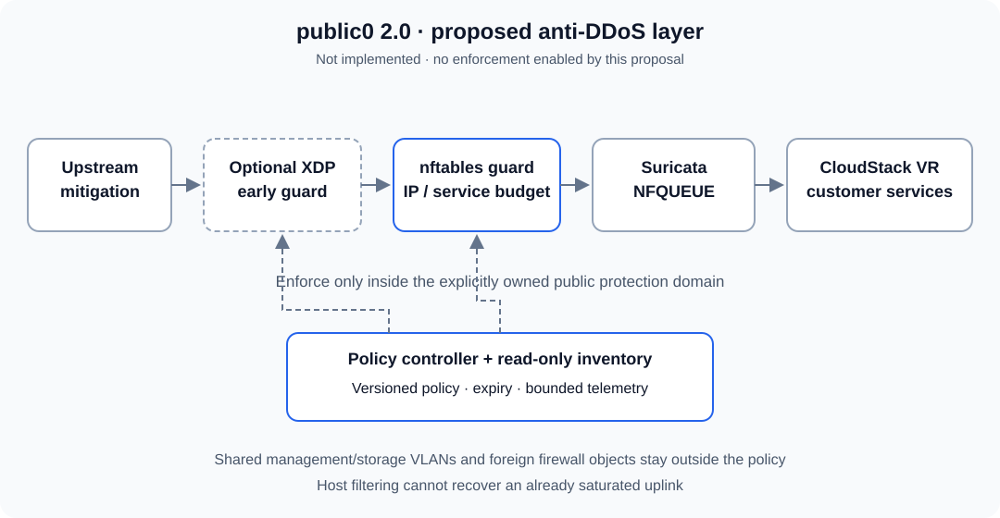

# public0 2.0: proposed anti-DDoS architecture

Status: **proposal, not implemented**. Finish and qualify the current inline
release before activating this layer. Publishing this design does not enable
packet drops or authorize attack traffic against a production network.

## Goal and limits

Protect shared hypervisor CPU, receive queues, NFQUEUE, virtual routers and
customer services from attack traffic that reaches the operator's public network
despite upstream mitigation. Containment should be specific to a protected public
IP/service so one attacked tenant does not consume every tenant's budget.

Host filtering cannot recover capacity already consumed on a saturated uplink.
Upstream scrubbing, provider filtering and suitable network capacity remain
necessary. No universal PPS/Gbit/s capacity or attack-prevention guarantee is made.
HTTPS application abuse also needs an application/WAF layer at TLS termination.

## Data path

| Layer | Responsibility | Boundary |
|---|---|---|
| Upstream protection | Reduce traffic before the shared access link | Separate operator/provider contract |
| Optional native XDP guard | Cheap bounded L2/L3 checks and service budgets before skb allocation | Only qualified NIC/driver/VLAN paths |
| nftables guard before NFQUEUE | Versioned, destination/service-specific admission budgets | Dedicated owned objects, no global ruleset flush |
| Existing Suricata inline | Signature inspection of admitted traffic | Existing alert-only policy until explicitly changed |
| CloudStack VR and workloads | NAT, firewall, load balancing and application controls | Existing CloudStack configuration remains authoritative |

The portable first implementation uses nftables on the selected bridge before
the Suricata queue. A qualified ingress hook can move cheap checks earlier, but
bridge filtering does not remove the initial RX/IRQ and skb allocation cost.
XDP is an optional acceleration profile, not a dependency on every deployment.
Keep ingress and egress policies distinct: do not charge server replies against
an inbound request budget or impose the same protocol profile on both directions.

On shared trunks, management, storage, guest and public VLANs may use the same
NICs/bond. XDP must match an explicitly owned public protection domain before
enforcement. Missing VLAN metadata or an unsupported parse path must produce a
bounded counter and PASS, not a guessed tenant or a global drop. Qualify tagged,
untagged and bounded QinQ parsing, hardware VLAN stripping, bond slaves, jumbo
frames and multi-buffer support for each deployed NIC/driver/kernel combination.
Never disable host offloads blindly to make a prototype appear correct.

## Policy model

A policy identifies a protection domain, destination IP, protocol, optional
service port, direction, owner, generation and expiry. CloudStack is an optional
read-only inventory adapter; operators of other Linux bridges can supply the
same declarative mapping. A vnet name or current PID is not a stable tenant ID.

Use hierarchical budgets: an operator-defined host ceiling, reserved tenant shares
and per-service ceilings/bursts. Preserve a minimum legal-service allocation and
measure fair sharing under a simultaneous attack on one destination. Do not set
numeric production budgets until mixed-workload measurements establish them.
Do not use one source-IP limit as the main policy: spoofing defeats it and a
large legitimate NAT gateway can share one source address.

Start with explicit profiles for TCP SYN, established TCP, UDP services, ICMP and
fragments. Arbitrary UDP, all ICMP or all fragments must not be dropped by default.
Preserve PMTUD and required control traffic. Non-first fragments lack transport
ports at early hooks; apply a separately bounded L3 fragment policy or PASS them,
without inventing a service association. DNS, QUIC, VPN and other public UDP
services need their own legal-traffic fixtures and policy.

Host TCP syncookies do not protect a forwarded guest's TCP state. SYN proxying
would be a separate optional feature requiring sequence, MSS/SACK, NAT, migration
and HA qualification. It is outside the first nftables implementation.

## Bounded implementation

- Preallocate only known protection-domain/service entries. Packets with random
  spoofed sources must not create unbounded per-source maps or nft sets.
- Set explicit entry, memory, update-rate and telemetry-cardinality bounds.
  Map/set exhaustion must have a documented coarse service-budget fallback.
  An LRU map alone is insufficient: evictions can reset an attacker's allowance.
- Account for all CPUs. Per-CPU token buckets cannot silently multiply the
  configured aggregate allowance by the number of CPUs. Measure shared-lock
  contention or prove partitioned quotas and aggregate burst bounds.
- Qualify units at every hook: wire frames, skb/GSO packets and application
  requests differ. Stage counters must not count the same drop twice.
- Use atomic generation updates limited to owned nft tables or exact BPF program
  IDs/map handles. Preserve foreign XDP/tc attachments, qdiscs and firewall rules.
  An existing foreign attachment requires explicit coexistence or refusal.

## Control and failure behavior

Policies have per-profile **OFF**, **OBSERVE** and **ENFORCE** modes. The initial
installation is OBSERVE with no anti-DDoS drops. Promotion requires a reviewed
policy, measured limits, an agreed host/window and a tested rollback path.
Neither a single Suricata alert nor an LLM decision may impose a global ban.

A local agent validates a versioned, authenticated policy snapshot. The packet
path continues without the central controller. Temporary mitigations expire
using kernel/monotonic deadlines; expiry returns them to observation/PASS and
reports degraded protection. This trades protection for availability explicitly.
Any permanent baseline guard is a separate, immutable approved policy. A watchdog
outside the agent detects expired state; a stale dashboard is not a rollback
instruction. Emergency isolation of a tenant/service is a separate operator action.

Inventory generations must follow VR migration, failover and public-IP reassignment.
Stage a new host mapping atomically, preserve the stable protection-domain ID and
remove old ownership after verified handoff. Uncertain or expired mapping must
be visible as UNKNOWN; never enforce an old tenant policy on a newly assigned IP.
Do not modify CloudStack-managed NAT/firewall rules inside its virtual routers.

## Observability and acceptance

Record received, admitted and dropped observations per stage and bounded policy
class, with reason, policy generation, expiry, map occupancy/exhaustion and parse
support. Keep NFQUEUE kernel/user/netlink loss and unknown accounting separate
from deliberate anti-DDoS drops. Monitor per-core CPU, IRQ/softirq, memory, NIC
queues, VR health and customer goodput/latency. Avoid raw customer payload exports
and unbounded IP labels in Prometheus; detailed top-N views need bounded sampling
and an explicit privacy/retention policy.

Use an isolated, owned lab and an external owned generator. Include small packets,
sustained load and bursts, distributed/spoofed sources, legal NAT clients, TLS,
HTTP/2, UDP/QUIC, fragments, MTU 1500/9000 and actual VLAN offload combinations.
Exercise CPU pressure, full maps/sets, controller/agent failure, policy expiry,
reboot, kernel rejection, foreign attachments and VR migration/HA. Preserve legal
flows and prove rollback ownership. No public Internet or customer attack tests.

Before enforcement, define measured capacity, legitimate loss/goodput and latency
SLOs for each profile. Compare identical legal workloads with and without the
guard, both idle and under attack. Include all guard/Suricata/userspace/kernel
IRQ costs and effects on storage and other tenants. An idle CPU mean is not a
protection budget. Our current acceptance proposal requires at least 20% reserve
in the measured protection CPU budget, at most 10% service and Ceph p99 increase
against a comparable baseline, no unexplained legitimate NFQUEUE drops and
forwarding recovery within 5 seconds; stricter existing SLOs take priority.
These are acceptance targets, not achieved measurements or a community-wide SLO.

## Delivery sequence

1. Finish the current monitor fix, safe alert-only rule updates and existing
   performance/operational acceptance. Keep anti-DDoS enforcement off.
2. Review this proposal and agree inventory mapping, service profiles, budgets,
   expiry behavior and legal-traffic SLOs. Publish the generic policy schema.
3. Implement a bounded nftables prototype and isolated failure/traffic fixtures.
4. Add optional XDP acceleration only where the hardware/kernel capability matrix
   and measurements justify it; preserve a documented nftables-only profile.
5. Observe on one explicitly selected host and compare measurements. Promote
   only selected service profiles, with manual decision and tested rollback.
6. Release public0 2.0 with IaC, migration guide, license/SBOM, tests, compatibility
   matrix and reproducible benchmark methodology. Broader rollout follows canary
   acceptance, never a dashboard green state alone.

Generic implementation and documentation ship in `cs-public0` alongside downstream
deliveries. Environment inventories, credentials, raw traffic and signature feeds
are not community release artifacts. Use public commit/PR references to track parity.

## Alternatives and references

A generic iptables anti-DDoS script is unsuitable as the deployment base: it can
flush foreign rules and target host INPUT while the protected CloudStack traffic
is forwarded. Reuse reviewed concepts, not privileged installer scripts. XDP-only
deployment would restrict portability and still needs policy/control qualification.
Upstream-only mitigation leaves residual traffic; Suricata-only admission spends
the expensive queue/inspection budget before protection.

- [Linux XDP receive metadata and driver-dependent VLAN access](https://docs.kernel.org/networking/xdp-rx-metadata.html)
- [Kernel BPF hash maps, per-CPU variants and LRU behavior](https://docs.kernel.org/bpf/map_hash.html)
- [nftables bridge filtering](https://wiki.nftables.org/wiki-nftables/index.php/Bridge_filtering)
- [Netfilter hook order and ingress fragment limitations](https://wiki.nftables.org/wiki-nftables/index.php/Netfilter_hooks)
- [CloudStack VPC and virtual-router roles](https://docs.cloudstack.apache.org/en/4.20.0.0/adminguide/networking/virtual_private_cloud_config.html)
- [mitigra/antiddos source reviewed as an example, not a deployment dependency](https://github.com/mitigra/antiddos/blob/main/antiddos.sh)
